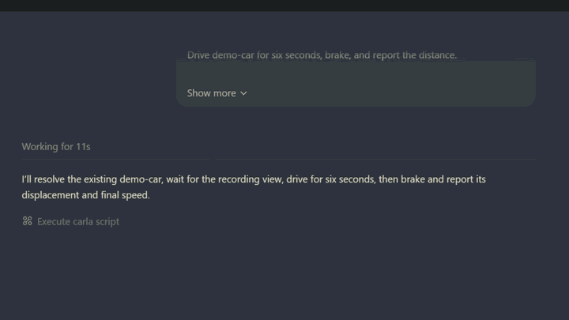
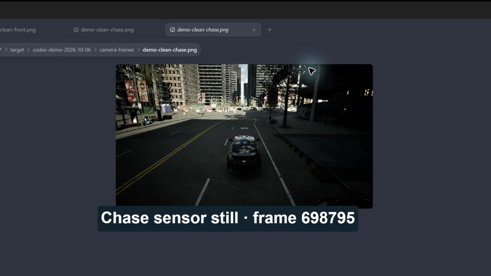
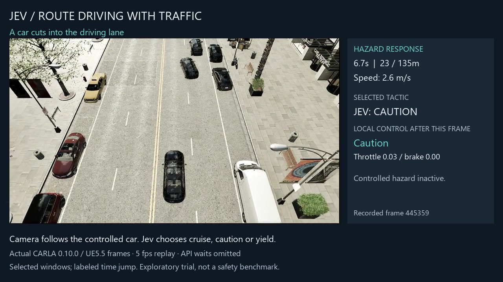

<div align="center">

# CARLA Agentic Toolkit

**A local MCP server that lets AI coding agents run CARLA Python inside a Linux sandbox, with journaled cleanup of only the actors they create.**

[](https://github.com/sidkolapalli/carla-agentic-toolkit/actions/workflows/ci.yml)
[](LICENSE)
[](docs/alpha-release-notes.md)

**[What it does](#what-it-does)** · **[Quick start](#quick-start)** · **[Demo](#demo)** · **[Status and limits](#status-and-limits)** · **[Documentation](#documentation)**

</div>

## What it does

An agent such as Codex, Claude Code, or VS Code writes a finite Python workflow
for [CARLA](https://github.com/carla-simulator/carla), the open-source driving
simulator, and sends it to one MCP tool, `execute_carla_script`. The script runs
against a curated `api` object:

- **Sandboxed, fail-closed.** A Rust runner applies Linux Landlock filesystem
  and TCP-port rules plus resource limits before any model-written code runs. An
  AST script validator adds defense in depth; it does not replace Landlock. If
  the kernel cannot enforce every rule, the script does not run.
- **Cleans up only its own actors.** Each created actor ID is journaled. After an
  uncaught exception or timeout, a separate trusted process destroys only those
  IDs; actors that already existed are never discovered, adopted, or deleted.
  Successful scripts keep their actors unless they remove them.
- **Restores settings.** All six world-settings fields are journaled before the
  first change, then restored and verified when a finite script finishes. Attempted
  Traffic Manager global settings are reset to documented targets, since CARLA
  cannot read back their originals. Unverified restoration leaves the simulator
  marked dirty instead of reported clean.
- **Returns evidence.** JSON results, camera images, and local output files.

Details: [security policy](SECURITY.md) · [script workflows](docs/script-workflows.md).

## Quick start

> [!IMPORTANT]
> - Linux, or Windows 11 through WSL2, with **kernel 6.15 or newer** for Landlock
>   ABI V7. Older kernels, including the WSL2 6.6 kernel, fail closed.
> - **Python 3.12** (pin it; newer distributions may default to 3.14, which CARLA
>   0.9.16 does not support), [uv](https://docs.astral.sh/uv/), and **Rust** with
>   a C/C++ linker.
> - A **running CARLA server** whose version matches the CARLA Python client you
>   install. CARLA is installed separately.

Other setups: [Windows 11 / WSL2](docs/client-setup.md#windows-11-with-wsl2) · [Docker](docs/client-setup.md#docker-mcp-server) · [CARLA 0.10.0 / UE5 client](docs/client-setup.md#carla-release-compatibility)

### 1. Install and check the sandbox

This example uses **CARLA 0.9.16**. For another simulator version, install its
matching Python API instead.

```bash
git clone https://github.com/sidkolapalli/carla-agentic-toolkit.git
cd carla-agentic-toolkit
uv sync --locked --python 3.12
uv pip install --python .venv "carla==0.9.16"
cargo build --locked --manifest-path sandbox-runner/Cargo.toml --release

export CARLA_AGENTIC_TOOLKIT_HOME="$(pwd)"
export CARLA_AGENTIC_TOOLKIT_OUTPUT_DIR="$HOME/carla-agentic-toolkit-output"
export UV_BIN="$(command -v uv)"
mkdir -p "$CARLA_AGENTIC_TOOLKIT_OUTPUT_DIR"

uv run --no-sync carla-agentic-toolkit-preflight
```

Continue only when preflight reports **`ok: true`** and **`ruleset_enforced: true`**.
The Python wheel alone does not include the Rust runner.

### 2. Connect your agent

For Codex on Linux, in the same shell:

```bash
codex mcp add carla-agentic-toolkit --env "CARLA_AGENTIC_TOOLKIT_OUTPUT_DIR=$CARLA_AGENTIC_TOOLKIT_OUTPUT_DIR" -- \
  "$UV_BIN" --directory "$CARLA_AGENTIC_TOOLKIT_HOME" run --no-sync carla-agentic-toolkit
codex mcp list
```

[Claude Code setup](docs/client-setup.md#2-claude-code) ·
[VS Code setup](docs/client-setup.md#4-vs-code) ·
[Codex settings and timeouts](docs/client-setup.md#3-openai-codex)

### 3. Send a first request

With CARLA running, ask your agent (add host and RPC port if not `127.0.0.1:2000`):

> Use the CARLA toolkit to check the connection. Tell me the simulator version,
> map, and actor counts without changing the world.

Then, in a dedicated simulation:

> Spawn one car at an available spawn point and name it demo-car. Capture a front
> camera image and show it to me. Remove the camera when you're done, and leave
> the car parked for my next request.

`execute_carla_script` is marked destructive, so clients normally ask for your
approval unless local client policy auto-approves it. For a scripted check with
recorded results and cleanup, follow the [step-by-step demo](docs/alpha-demo.md).

## Demo

> Drive demo-car for six seconds, brake, and report the distance.

<p align="center">
  
</p>

<details>
<summary><strong>Play the full drive demo · 47 seconds</strong></summary>

https://github.com/user-attachments/assets/2d9712dc-3e64-4e0c-b905-f31241eaeda0

</details>

Codex drives the prepared car for six wall-clock seconds in an asynchronous,
variable-step world, brakes, and reports **18.75 m of displacement including
stopping**. The figure compares recorded 3D endpoints; it is illustrative, not
repeatable. The full Recordly edit shows the prompt, labeled 8× agent work, and
driving at 1× speed.

| See through the car's cameras |
| --- |
|  |
| **[Watch · 37 seconds](https://github.com/user-attachments/assets/a3b3001c-5793-45de-bc6d-b84e142cdfad)** — Codex retrieves real front and chase sensor images, then removes its cameras. |

<details>
<summary>Play the camera demo · 37 seconds</summary>

https://github.com/user-attachments/assets/a3b3001c-5793-45de-bc6d-b84e142cdfad

</details>

These demos use a configured simulator and an already named car; camera views are
captured stills. They are not safety or response-time benchmarks.
[Recording details](docs/evidence/codex-demos-2026-10-06/README.md)

## Status and limits

**Experimental alpha** for local research. It does not establish
autonomous-driving safety or production reliability.

- **CARLA 0.9.16 / UE4:** retained live validation with a matching client and
  server on Python 3.12; Docker defaults to this version.
- **CARLA 0.10.0 / UE5:** scoped experimental validation, including the demos
  above; some features, such as weather, differ or are unavailable. See the
  [UE5 findings](docs/evidence/ue5-validation-2026-10-05/README.md).
- **Platforms:** Linux, or Windows 11 through WSL2. Native macOS, native Windows
  execution, WSL1, and hosted remote service are unsupported.
- **Trust model:** local stdio, single user, no authentication. The sandbox
  covers generated scripts, not the coding agent. Landlock filters ports, not
  hosts. The simulator lease cannot stop unrelated CARLA clients; use a dedicated
  simulator on a trusted network.
- **Traffic Manager:** autopilot needs a trusted Traffic Manager running outside
  the sandbox; toolkit traffic workflows are asynchronous-only.

Known issues: [alpha release notes](docs/alpha-release-notes.md).

## Optional: managed experiments with Jev

Opt-in managed experiments run validated numerical specifications (no code) in a
trusted worker outside the sandbox, with a no-key rules policy as the baseline.
Optionally, [Jev, TypeSafe's System One model](https://typesafe.ai/blog/introducing-system-one-models-and-jev),
selects from supplied driving tactics using numerical simulator state, not camera
images; local code still owns steering, throttle, braking, fallbacks, and
cleanup. Jev needs the optional SDK and `TYPESAFE_API_KEY` in the trusted
environment; nothing above requires it.

<details>
<summary>Play the route experiment demo · 80 seconds</summary>



https://github.com/user-attachments/assets/2749e704-e5ab-4de7-9a24-bb70a2bd3442

</details>

Jev selects `cruise`, `caution`, or `yield` along a 135 m route with controlled
traffic. The video samples recorded frames and omits waiting; **its attempted
pedestrian crossing was not achieved**.
[Run a rules/Jev comparison](docs/managed-experiments.md) ·
[Follow a route with traffic](docs/route-experiments.md) ·
[Route results and limitations](docs/evidence/route-hazards-2026-10-05/README.md) ·
[See six analytical graphs](docs/evidence/route-study-2026-10-05/README.md) ·
[Watch a merge and budget fallback · 40 seconds](docs/evidence/managed-demo-2026-10-03/README.md)

## Documentation

| I want to… | Guide |
| --- | --- |
| Install, connect a client, or troubleshoot | [Client setup](docs/client-setup.md) |
| Understand scripts, images, saved outputs, and cleanup | [Script workflows](docs/script-workflows.md) |
| Keep state across requests | [Persistent script sessions](docs/persistent-sessions.md) |
| Work with synchronous sensors | [Sensor timing](docs/sensor-timing.md) |
| Run and compare driving experiments | [Managed experiments](docs/managed-experiments.md) and [route experiments](docs/route-experiments.md) |
| Inspect decisions and reproduce results | [Experiment evidence](docs/experiment-evidence.md) and [managed architecture](docs/managed-architecture.md) |
| Review the sandbox boundary or report a vulnerability privately | [Security policy](SECURITY.md) |

## Contributing

Improvements to workflows, CARLA compatibility, tests, and documentation are
welcome. Start with [CONTRIBUTING.md](CONTRIBUTING.md) and the
[GitFlow guide](docs/gitflow.md): ordinary contributions branch from and open
PRs into `develop`; `main` tracks released work. Follow the
[Code of Conduct](CODE_OF_CONDUCT.md).

## License and credits

[MIT](LICENSE) © 2026 Siddharth Kolapalli. Built on
[CARLA](https://github.com/carla-simulator/carla),
[MCP](https://modelcontextprotocol.io/), and [Landlock](https://landlock.io/).
CARLA-specific code is MIT and CARLA-specific assets are CC-BY, as stated in the
[upstream licence notice](https://github.com/carla-simulator/carla/blob/0.10.0/README.md#licenses).
The [preview GIF and scene credits](docs/assets/readme/README.md) and each
evidence README retain the applicable asset attribution independently of the
toolkit's MIT licence. This community project is not affiliated with or
endorsed by CARLA, TypeSafe, or the featured coding-agent providers.
